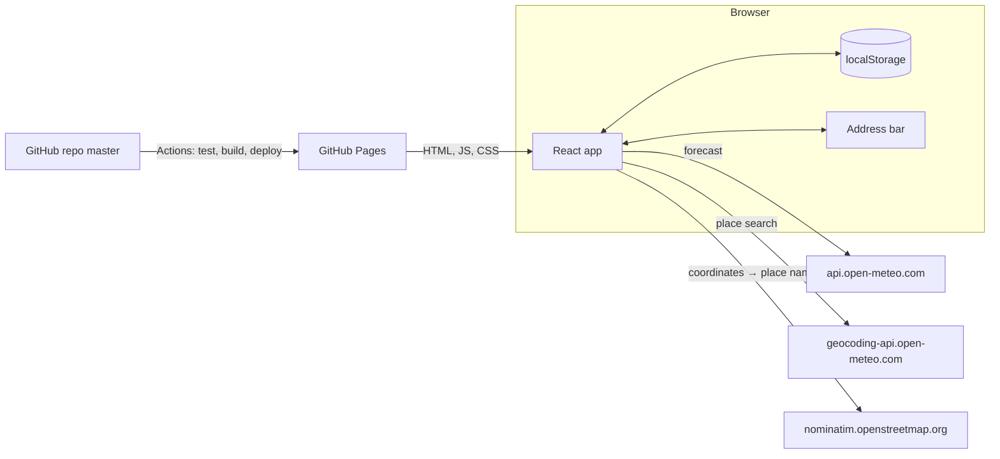
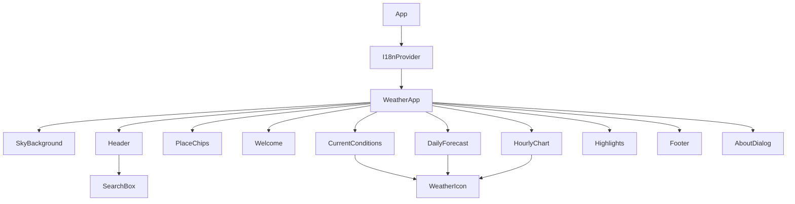
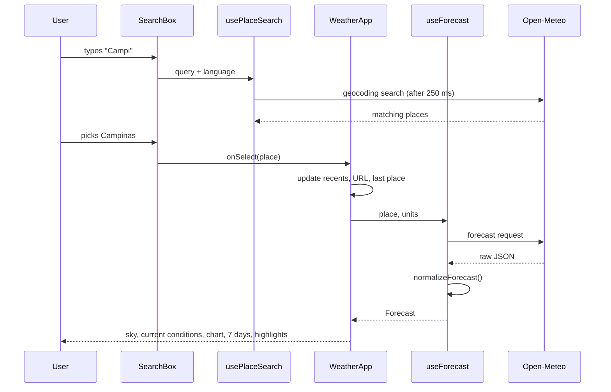

# Architecture

How Hayashi Weather is put together and why. For what the product does see [PRODUCT.md](PRODUCT.md), for the tests see [TESTING.md](TESTING.md), and for day-to-day conventions see [CLAUDE.md](CLAUDE.md).

## Overview

Hayashi Weather is a **static single-page app**: React 19 + TypeScript, built by Vite into plain HTML, CSS and JavaScript (about 93 KB gzipped) and served by GitHub Pages. There is no server of our own. The visitor's browser calls two free, keyless APIs directly.



## Source layout

```
src/
  main.tsx               entry: global CSS, then <App />
  App.tsx                I18nProvider + page state, layout and wiring
  types.ts               Place, Forecast and friends (the app's data model)
  api/                   talking to the outside world
    http.ts              fetch wrapper, ApiError codes
    forecast.ts          Open-Meteo forecast request + normalizeForecast
    places.ts            place search (Open-Meteo) and reverse geocoding (Nominatim)
  hooks/                 React glue
    useForecast.ts       load the forecast for a place and units
    usePlaceSearch.ts    debounced autocomplete
    useStoredState.ts    useState backed by localStorage
    useNow.ts            clock that ticks every minute
  i18n/                  languages
    en.tsx, pt.tsx, es.tsx   all user-facing text (en defines the Messages type)
    languages.ts         detection, locale choice, default units
    I18nProvider.tsx     context with t, format, language, locale
    useI18n.ts           hook to read that context
  lib/                   pure functions, no React
    format.ts            locale-aware dates and numbers, place-local time
    weatherCodes.ts      WMO code → weather kind and label
    sky.ts               weather + time of day → sky theme
    placeUrl.ts          shareable ?name=&lat=&lon= links
    storage.ts           safe localStorage access and keys
  components/            UI, one CSS module per component
  styles/global.css      design tokens, base styles, .card
  test/                  setup and fixtures
```

Dependencies only point one way: **components → hooks → api / lib → types**. `lib/` and `api/` never import React components, which keeps them easy to test on their own.

## Component tree



`Welcome` shows until a place is chosen; after that the forecast cards replace it. `WeatherApp` lays the cards out with CSS grid areas: on desktop, current conditions and the hourly chart on the left, the 7-day list on the right, and the highlights across the bottom. On narrow screens everything stacks in one column.

## State

There is no state library. All shared state lives in `WeatherApp` and flows down as props, with the language in a React context.

| State                    | Where                             | Persisted                            |
| ------------------------ | --------------------------------- | ------------------------------------ |
| Current place            | `WeatherApp` (`useState`)         | URL query + `last-place`             |
| Forecast, loading, error | `useForecast(place, units)`       | No (fetched each visit)              |
| Units °C/°F              | `useStoredState`                  | `units`                              |
| Favorites, recents       | `useStoredState`                  | `favorites`, `recents`               |
| Selected day             | `WeatherApp`                      | No                                   |
| Language                 | `I18nProvider` (`useStoredState`) | `language`, only when picked by hand |
| Search text and results  | `SearchBox` + `usePlaceSearch`    | No                                   |
| Current time             | `useNow` inside `HourlyChart`     | No                                   |

Storage keys are prefixed `hayashi-weather:` and listed in `STORAGE_KEYS`. All access goes through `readStored`/`writeStored`, which fall back to defaults when storage is blocked (private browsing), so the app works without it.

## Startup

1. `main.tsx` loads the global CSS, then renders `<App />`.
2. `I18nProvider` picks the language: a stored manual choice, otherwise the first supported entry in `navigator.languages`, otherwise English. It also picks the locale for dates and numbers, keeping the browser's region when it matches (`es-MX`, `en-GB`), and sets `<html lang>`.
3. `WeatherApp` picks the place: a shared link in the URL first, then the last place viewed on this device, otherwise none (the welcome screen).
4. Units come from storage, or default to °F for US, Liberian and Myanmar locales and °C everywhere else.
5. With a place, `useForecast` fetches the forecast; the sky, cards and page title render from it.

## Data flow



**Requests are cancellable.** `useForecast` and `usePlaceSearch` give every request an `AbortController` and abort it when the inputs change or the component unmounts, so a slow old response can never overwrite a newer one. While a new forecast loads, the previous one stays on screen, dimmed, instead of flashing a skeleton.

**One normalization step.** `normalizeForecast` turns Open-Meteo's column-oriented JSON (one array per variable) into the app's `Forecast` type (arrays of objects). Everything after that point works with `types.ts`, so an API change only touches `api/forecast.ts`.

The forecast request asks for current conditions, hourly data and daily data in one call, with `timezone=auto`, `forecast_days=7` and `past_days=1`. The extra past day exists so the hourly chart can show the 12 hours before now. `normalizeForecast` keeps all hourly entries (starting yesterday at 00:00) but trims the daily list to start today, and records `nowIndex` (the current hour in `hourly`) and `utcOffsetSeconds`.

## Time handling

Open-Meteo returns times **local to the place**, without a timezone (`"2026-10-29T14:15"`). Converting them with `new Date()` would shift them into the viewer's own timezone, so a visitor in Tokyo would see Campinas's sunrise at the wrong hour.

Instead, `parseLocal` treats them as UTC and every formatter in `createFormat` formats in UTC. The digits never move, whatever timezone the visitor's device is in. For the place's current time, `localNow(utcOffsetSeconds)` adds the place's offset to `Date.now()`. The hourly chart uses that, refreshed every minute by `useNow`, to position the "now" marker.

## Internationalization

There is no i18n library. Each language is a TypeScript object:

- `en.tsx` defines the shape (`Messages`), and `pt.tsx` and `es.tsx` must match it, so a missing translation fails type-checking.
- Text with variables is a function (`localTime: (time) => ...`); text with links returns JSX (`aboutIntro(mead)`).
- API errors carry a code (`ApiError.code`), and the UI shows `t.errors[code]`, so error messages are translated too.
- **Dates and numbers** are not translated by hand: `createFormat(locale)` builds `Intl` formatters once per locale. That gives 12/24-hour clocks, month and weekday names and decimal separators for free, even for regional variants like `pt-PT`.
- **Place names** come from the APIs in the chosen language (`language` and `accept-language` parameters).

Components read `t` and `format` with `useI18n()`. Changing the language re-renders the tree with new values; nothing is refetched except new searches.

## Sky and visuals

`pickSky` (pure, in `lib/sky.ts`) maps the current weather code, `is_day`, and the time relative to sunrise and sunset to a **theme** (13 options, from `clear-day` to `storm`) and an **effect** (clouds, drizzle, rain, storm, snow, fog or none), plus stars for clear nights. Dawn and dusk apply within 45 minutes of sunrise and sunset.

`SkyBackground` is a fixed layer behind the page (`z-index: -1`):

- The gradient comes from three CSS custom properties per theme. They are registered with `@property` as colors, so switching cities fades the sky instead of jumping.
- Effects are extra layers: SVG-pattern rain moving diagonally, radial-gradient snow and stars, blurred cloud and fog bands, and a lightning flash.
- `body` has no background on purpose: it would paint over a negative z-index layer. The fallback page color sits on `:root`.

Cards are frosted glass (`.card`: translucent background + `backdrop-filter`), so the sky shows through every section. Weather and UI icons are inline SVG components. Only the large current-conditions icon animates. A global `prefers-reduced-motion` rule turns off all animation and transitions.

## Styling

- **CSS Modules**, one per component (`Component.module.css`), scoped automatically by Vite.
- **Design tokens** (colors, radii, shadow, font stack) are CSS custom properties in `global.css`, alongside the shared `.card` and `.card-title` classes. Global CSS is imported first in `main.tsx` so component styles can override it.
- **Responsive** by CSS grid: the layout switches to one column at 960 px, and components tighten up for phones with their own breakpoints between 720 and 380 px (header, highlights, day rows, current conditions).
- System fonts only, no web font download.

## Hourly chart

`HourlyChart` draws a hand-built SVG (no chart library):

- Each hour is a fixed-width column of 56 px, so the chart scrolls horizontally inside its card.
- The temperature line is a smooth Catmull-Rom curve converted to cubic Béziers, with a gradient area underneath.
- Icons are `WeatherIcon` SVGs placed with `foreignObject`.
- For today, `hoursForDay` returns 12 hours back and 24 ahead. `timePosition` puts the marker at the exact minute.
- On load, a layout effect scrolls the marker to the middle. It runs only when the forecast or day changes, not on each clock tick, so the chart doesn't jump while someone is scrolling it.

## Accessibility

- The search box follows the ARIA combobox pattern (`role="combobox"`, listbox, `aria-activedescendant`, full keyboard support).
- Each section is a `region` named by its heading, which is also how the tests find them.
- Toggles use `aria-pressed`, expandable days use `aria-expanded`, and errors use `role="alert"`.
- Charts and icons have text alternatives (the chart's label lists every hour and temperature).
- The About dialog is a native `<dialog>` opened with `showModal()`, which provides focus trapping and Esc to close.

## Build and deploy

- `npm run build` runs `tsc --noEmit`, then `vite build` into `dist/`.
- `base: './'` makes every asset path relative, so the same build works at the site root or under `/weather-website/` on GitHub Pages.
- `.github/workflows/deploy.yml` runs on every push to `master`: `npm ci`, `npm test`, build, then publishes `dist/` with the official Pages actions. A failing test stops the deploy.

## Key decisions

| Decision                          | Why                                                                          | Trade-off                                               |
| --------------------------------- | ---------------------------------------------------------------------------- | ------------------------------------------------------- |
| Static site, no backend           | Free hosting, nothing to maintain or secure, no API keys to hide             | Bound by the APIs' free terms; no server-side caching   |
| Browser calls APIs directly       | Open-Meteo and Nominatim allow it (CORS) and need no keys                    | Rate limits apply per visitor, which suits this traffic |
| No router                         | One page; the place lives in the query string                                | A second page would need one                            |
| No state library                  | State is small and lives in one component                                    | Prop passing from `WeatherApp`                          |
| Own i18n (typed objects + `Intl`) | ~5 KB instead of ~40 KB for a library; typed keys catch missing translations | No pluralization helpers or lazy-loaded languages       |
| Hand-built SVG chart and icons    | Exact look, tiny size, no icon font                                          | More code to maintain than a library                    |
| CSS Modules + custom properties   | Scoped styles with no runtime cost; themes are just variables                | No utility classes                                      |
| Format times in UTC               | Place-local times stay correct in any viewer timezone                        | Must never use `new Date(apiTime)` directly             |

## Extending

- **Add a language:** copy `en.tsx` to a new file typed as `Messages`, translate it, then in `languages.ts` add its code to the `Language` type, `MESSAGES` and `DEFAULT_LOCALES`. Include it in the weather-label completeness test in `lib.test.ts`.
- **Add a weather variable:** request it in `api/forecast.ts`, add it to `RawForecast`, `normalizeForecast` and `types.ts`, add realistic values to `test/fixtures.ts`, then show it (a new `Tile` in `Highlights` is the easiest place) with text in all three languages.
- **Add a sky theme or effect:** extend the `SkyTheme`/`SkyEffect` types and `pickSky`, add the colors under `.sky[data-theme=...]` in `SkyBackground.module.css`, add the layer in `SkyBackground.tsx`, and cover the rule in `lib.test.ts`.
- **Add a new data source:** it must be free, keyless and allow browser calls (CORS). Put the client in `api/`, return `ApiError` codes on failure, and add the attribution its terms require to the footer and About dialog.
